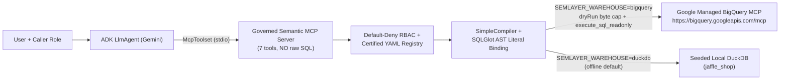

# Certified BigQuery MCP Semantic Layer Agent

`certified-bigquery-mcp` demonstrates how to place a **certification-gated semantic layer** between an ADK `LlmAgent` and Google's managed BigQuery MCP server (`https://bigquery.googleapis.com/mcp`). Instead of handing the LLM a raw SQL tool over production warehouse tables, the agent connects via `McpToolset` to a governed local MCP server (`app.mcp_server`) that serves **only human-certified YAML definitions** with default-deny RBAC, row-level filters, sensitive-dimension restrictions, `sqlglot` AST literal binding, and BigQuery `dryRun` byte caps.

For zero-credential local development and CI testing, the recipe includes a deterministic `jaffle_shop` certified registry and an offline `DuckDB` fallback warehouse that seeds automatically on first run.

## Architecture



### Key Governance Controls

- **No Raw SQL Surface**: Agents only see `list_metrics`, `describe_metric`, `query_metric`, `describe_graph`, `traverse_graph`, `report_gap`, and `report_issue`. Draft and deprecated metrics (such as `revenue_v2`) are never served.
- **Default-Deny RBAC**: Access requires a `certified` `Rule` matching `as_role`. Rules enforce row-level predicates (for example, `eu_analyst` sees `customer_count` restricted to `region = 'EU'`) and sensitive column blocks (`deny_dims: [email]`).
- **SQLGlot AST Literal Binding**: Filter values and entity keys are bound into `sqlglot.exp` AST literal nodes (`render_sql`), re-parsed under the BigQuery dialect, and verified to be a single `SELECT` statement with zero remaining placeholders.
- **Read-Only BigQuery MCP + Dry-Run Byte Cap**: `BigQueryMCP` invokes **only** `execute_sql_readonly` on `https://bigquery.googleapis.com/mcp` and checks estimated scan bytes via `dryRun` against `SEMLAYER_BQ_MAX_BYTES` before executing.

## Prerequisites & Setup

Ensure you have Python 3.11+ and [`uv`](https://docs.astral.sh/uv/getting-started/installation/) installed. All commands below run from `examples/adk_agent/`.

1. Install dependencies:

   ```bash
   uv sync --dev
   ```

2. Configure environment variables:

   ```bash
   cp .env.example .env
   ```

   - **Model**: `MODEL_NAME` defaults to `gemini-3.7-flash`. Configure either `GEMINI_API_KEY` (Google AI Studio) or `GOOGLE_GENAI_USE_VERTEXAI=True` with `GOOGLE_CLOUD_PROJECT` and Application Default Credentials (`gcloud auth application-default login`).
   - **Offline DuckDB Mode (default)**: Leave `SEMLAYER_WAREHOUSE=duckdb`. A deterministic 60-customer / 300-order `jaffle_shop` DuckDB database is seeded automatically on first query.
   - **Live BigQuery MCP Mode**: Set `SEMLAYER_WAREHOUSE=bigquery`, set `SEMLAYER_BQ_PROJECT` (or `GOOGLE_CLOUD_PROJECT`) to your real GCP project ID, set `SEMLAYER_BQ_DATASET=jaffle_shop`, and enable the BigQuery MCP service in your project with `roles/bigquery.jobUser` and `roles/bigquery.dataViewer`.

## Running the Agent

Start the interactive ADK CLI:

```bash
uv run adk run app
```

Or launch the ADK web UI / FastAPI server:

```bash
uv run adk web
# or
uv run uvicorn app.fast_api_app:app --reload --port 8080
```

### Example Prompts

- *"As role `finance`, what is our certified revenue broken down by payment method?"* (calls `list_metrics` -> `query_metric`, cites `revenue (v2)`)
- *"As role `eu_analyst`, how many customers do we have, and what is our revenue?"* (returns EU-filtered `customer_count (v1)` and refuses `revenue` due to default-deny RBAC)
- *"As role `finance`, what is the certified revenue from customers who have a completed order?"* (calls `describe_graph` -> `traverse_graph` -> `query_metric` with `entity_keys`)
- *"What is our monthly customer churn rate?"* (abstains cleanly and records demand via `report_gap`)

## Running Tests

Run the offline runnability and governance unit tests (requires zero network calls and zero cloud credentials):

```bash
uv run pytest
```
